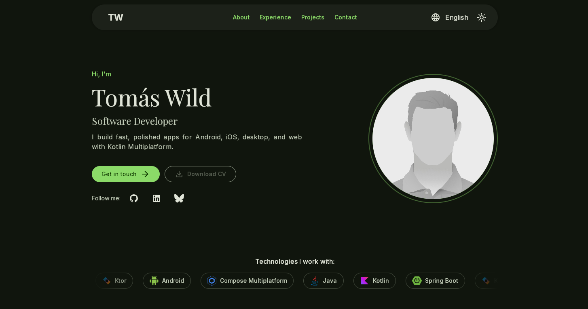
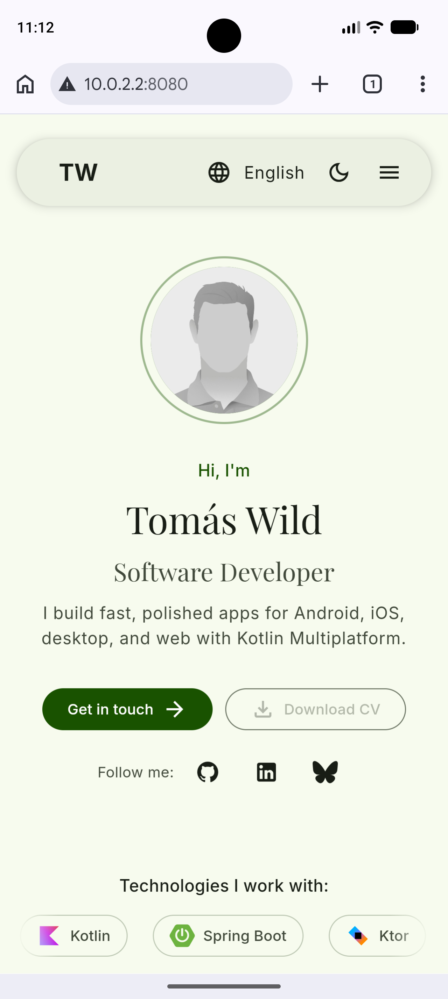

# Personal Developer Portfolio

A personal developer portfolio built with Kotlin Multiplatform and Compose Multiplatform, showcasing my projects,
technical skills, and experience through a responsive web application powered by WebAssembly.

## Overview

This portfolio provides a central place to explore my work, learn about my background, and get in touch.

The frontend is built entirely with Kotlin and Compose Multiplatform, demonstrating how Kotlin can be used to develop
modern web applications beyond traditional Android development.

## Screenshots

### Desktop

<p>
  
</p>

### Mobile

<p>
  
</p>

## Features

- **Responsive design:** Adapts to different screen sizes and devices.
- **Multilingual support:** Available in English, Spanish, and Simplified Chinese.
- **Theme switching:** Supports light and dark themes.
- **Professional experience:** Showcases my background, skills, and development experience.
- **Project showcase:** Highlights selected projects, technologies, and source code.
- **Contact section:** Provides ways to get in touch.

## Tech Stack

| Technology            | Purpose                                  |
|-----------------------|------------------------------------------|
| Kotlin                | Main programming language                |
| Kotlin Multiplatform  | Multiplatform project foundation         |
| Compose Multiplatform | Declarative UI framework                 |
| Kotlin/Wasm           | WebAssembly compilation target           |
| The Kotlin Toolchain  | Kotlin development and execution tooling |

## Getting Started

### Prerequisites

- JDK 25
- IntelliJ IDEA (recommended)
- Git

### Clone the repository

```git
git clone https://github.com/TomasWild/dev-portfolio.git
cd dev-portfolio
```

### Run locally

Use The Kotlin Toolchain run configuration to launch the application in your browser.

Alternatively, run the following command from the project root:

```bash
kotlin run
```

For more information, visit the [The Kotlin Toolchain](https://kotlin-toolchain.org/latest/).

## Live Demo

🔗 [Visit my portfolio](https://tomaswild.github.io/dev-portfolio/)

## License

Copyright © 2026 Tomás Wild. All rights reserved.

This repository is publicly available for viewing and educational purposes. You are welcome to read and study the source
code and take inspiration from the project. However, copying, modifying, redistributing, or using any part of the source
code, design, or personal content (including text, images, and branding) requires my prior written permission.
